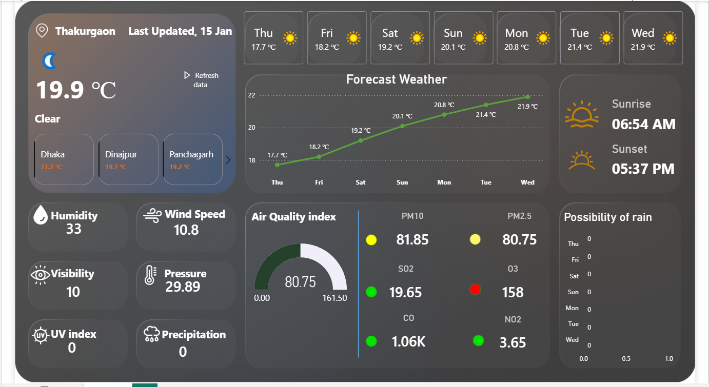
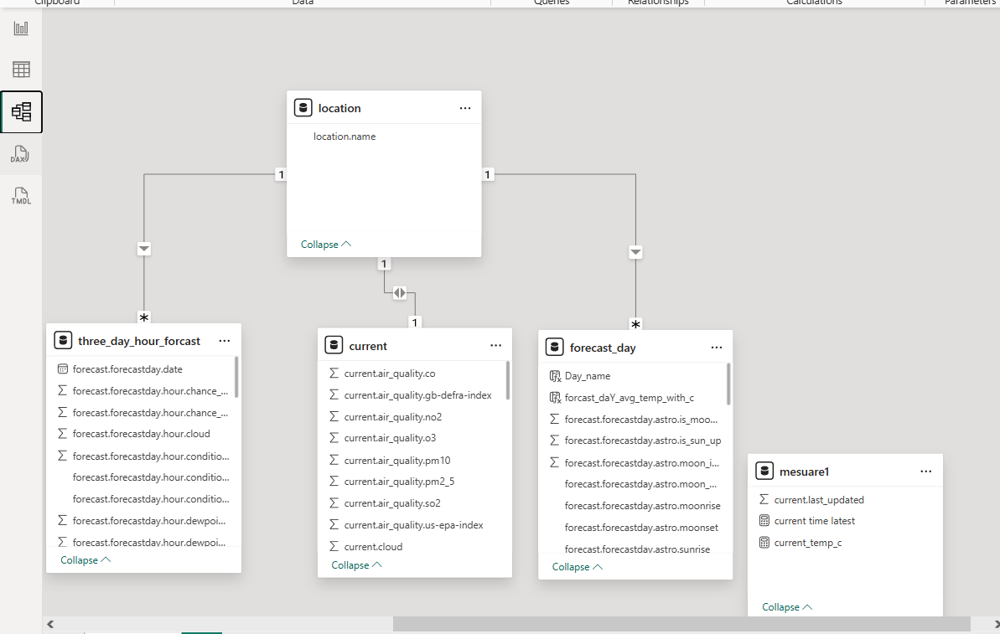
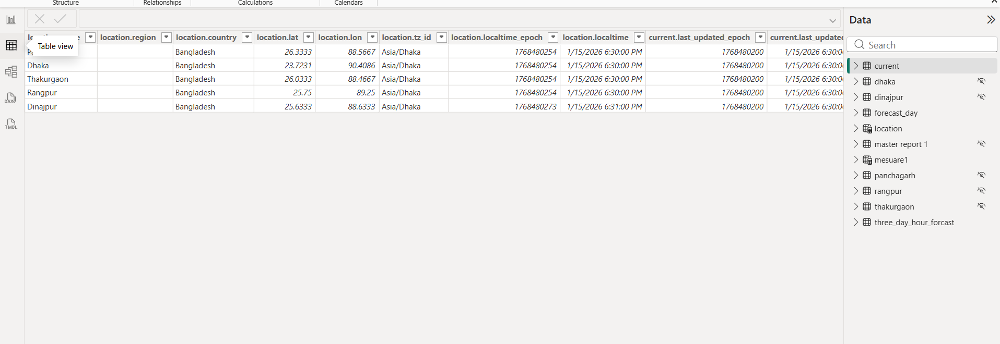

# The Forecast Factory-Weather Dashboard - Power BI Project

## 📌 Project Overview
A fully interactive weather dashboard built in Power BI that fetches live weather data from WeatherAPI.com, processes it, and presents it through dynamic visualizations. The dashboard provides real-time weather conditions and 7-day forecasts for Dhaka, Bangladesh.



## 🚀 Features

### 🔹 Data Integration
- **Live API Integration**: Connects to WeatherAPI.com to fetch real-time weather data
- **Automated Refresh**: Scheduled data refresh for up-to-date information
- **Multi-day Forecast**: 7-day weather forecast with temperature trends

### 🔹 Dashboard Visualizations
- **Current Weather Display**: Shows temperature, humidity, wind speed, and conditions
- **Forecast Timeline**: 7-day temperature trend visualization
- **Air Quality Monitoring**: PM2.5, PM10, and pollutant levels
- **Weather Metrics Panel**: Visibility, UV index, pressure, and precipitation
- **Interactive Elements**: Cross-filtering and drill-through capabilities

### 🔹 Data Processing
- **Data Cleaning**: Removed unnecessary columns and transformed JSON structure
- **Data Separation**: Split current weather and forecast data into separate tables
- **Calculated Measures**: Custom DAX calculations for enhanced analytics

## 📁 Project Structure
```
weather-dashboard-powerbi/
│
├── 📊 PowerBI Files/
│   ├── WeatherDashboard.pbix              # Main Power BI file
│   └── WeatherDashboard.pbit              # Power BI template 
├── 📁 Screenshots/
│   ├── dashboard_overview.png
│   ├── data_model_view.png
│   └── table.png
│
├── 📁 Data/
│   ├── Sample_Response.json              # Example API response
│   └── transformed_data_sample.csv       # Sample transformed data
│
├── 📁 Assets/
│   └── weather_icons/                    # Custom weather icons
│
├── requirements.txt                      # Project dependencies
├── README.md                            # This file
└── .gitignore                           # Git ignore file
```

## 🔧 Setup Instructions

### Prerequisites
1. **Power BI Desktop** (Latest version)
2. **WeatherAPI.com Account** (Free tier available)
3. **Git** installed on your machine

### Installation Steps

1. **Clone the Repository**
   ```bash
   git clone https://github.com/md-abid-sarkar/the-forecast-factory.git
   cd the-forecast-factory
   ```
   Configure API Key

2. **Sign up at WeatherAPI.com**

- Get your API key

- Open Power BI file

- Update the API query with your key:
```
http://api.weatherapi.com/v1/forecast.json?key=YOUR_API_KEY&q=DHAKA&days=7&aqi=yes&alerts=no
```
3. Open and Refresh Data

    - Open WeatherDashboard.pbix in Power BI Desktop

    - Click "Refresh" to fetch latest data

    - Configure scheduled refresh if publishing to Power BI Service

📊 Data Transformation Process
API Response Structure
```
{
  "location": {...},
  "current": {
    "temp_c": 21.2,
    "condition": {...},
    "humidity": 33,
    "wind_kph": 10.8
  },
  "forecast": {
    "forecastday": [...]
  }
}
```
Power Query Transformations Applied:

1. Parse JSON Response - Convert API response to structured tables

2. Extract Current Data - Create separate table for current conditions
3. Expand Forecast Array - Flatten forecast days into rows

4. Clean Columns - Remove unnecessary metadata

5. Data Type Conversion - Ensure proper data types for measures

6. Create Date Table - For time intelligence functions

🎨 Visualizations Included
1. Main Dashboard

   - Current temperature display

   - Weather condition icons

   - Key metrics cards

2. Forecast Analysis

   - Line chart for 7-day temperature trend

   - Daily high/low temperature bars

   - Precipitation probability indicators

3. Air Quality Dashboard

   - PM2.5 and PM10 gauges

   - Pollutant concentration bars

   - Air quality index score

4. Weather Metrics

   - Wind speed and direction

   - Humidity and pressure gauges

   - UV index and visibility indicators

🔄 API Integration Details
API Endpoint Used
```
GET /v1/forecast.json?key={API_KEY}&q={LOCATION}&days=7&aqi=yes&alerts=no
```
Parameters

    - q: Location (Dhaka)

    - days: Forecast days (7)

    - aqi: Air quality data (yes)

    - alerts: Weather alerts (no)

Response Handling

    - Automatic JSON parsing in Power Query
    - Error handling for API failures
    - Fallback to cached data if API unavailable


🔍 Troubleshooting
Common Issues & Solutions
Issue	-   Solution
API Key Expired	-   Renew API key at WeatherAPI.com
Data Not Refreshing	-   Check internet connection and API limits
Visuals Not Loading	-   Clear cache and restart Power BI
Missing Forecast Data	-   Verify API response format


API Rate Limits

    Free tier: 1,000,000 calls/month

    Max calls/minute: Varies by plan

    Monitor usage in WeatherAPI dashboard

📚 Future Enhancements
Planned Features

    Multi-location Support - Compare weather across cities

    Historical Data Analysis - Trend analysis over months/years

    Weather Alerts - Push notifications for severe weather

    Mobile Responsive - Optimized for mobile viewing

    Export Functionality - Export reports to PDF/Excel

Technical Improvements

    Incremental Refresh - For historical data

    DirectQuery Mode - Real-time data streaming

    Custom Visuals - Advanced weather-specific charts

    Automated Testing - Power BI test framework

🙏 Acknowledgments

    Weather data provided by WeatherAPI.com

    Icons from FlatIcon

    Power BI community for visualization inspiration
    the developer YouTube chenel https://youtube.com/@the-developer-bi?si=JpHjklckcssbAv_2


# Data Model

# Data table 

